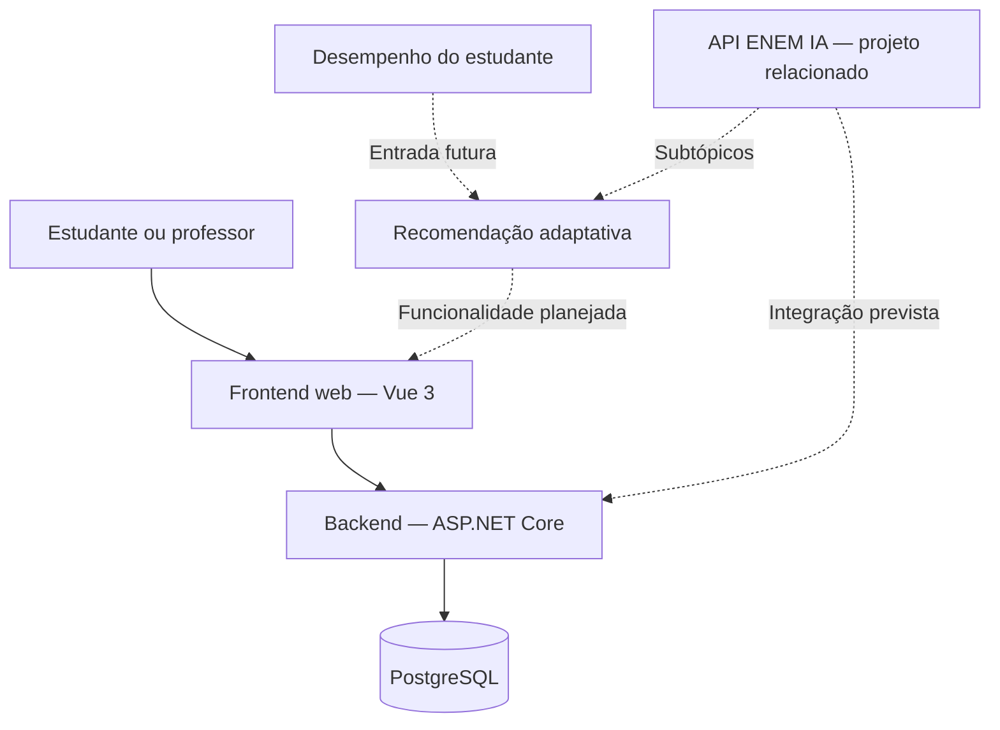
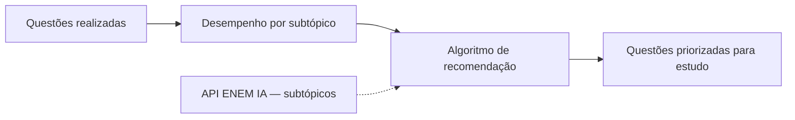

# Questibular — Engenharia de Software aplicada à educação

**Plataforma de preparação para o ENEM desenvolvida em equipe na disciplina de Engenharia de Software da Universidade de São Paulo (USP).**

O Questibular busca reunir simulados, questões do ENEM, correções e ferramentas de acompanhamento do estudo em um mesmo produto. Este repositório apresenta um **estudo de caso** sobre o processo de Engenharia de Software, a arquitetura da solução e minha participação no desenvolvimento.

| | |
|---|---|
| **Contexto** | MAC0332 / MAC5783 — Engenharia de Software, USP |
| **Minha atuação** | Desenvolvedor Full Stack, com participação no planejamento das sprints |
| **Frontend** | Vue 3, Vue Router, JavaScript, Bootstrap 5 e Vite |
| **Backend da equipe** | ASP.NET Core / .NET 10, Entity Framework Core e PostgreSQL |
| **Engenharia de Software** | Descoberta do problema, requisitos, personas, Product Backlog Building, histórias de usuário, prototipação e planejamento iterativo |
| **Situação** | Projeto acadêmico em desenvolvimento |
| **Projeto relacionado** | [API ENEM IA](https://github.com/RodrigoRLS2/enem-api-ia) |

> **Escopo e autoria:** o Questibular é um projeto coletivo. O código-fonte e os artefatos originais permanecem nos repositórios da equipe. Este repositório documenta o projeto e distingue as decisões compartilhadas, minhas responsabilidades e as funcionalidades ainda planejadas.

---

## Sumário

1. [O problema](#o-problema)
2. [Proposta do produto](#proposta-do-produto)
3. [Processo de Engenharia de Software](#processo-de-engenharia-de-software)
4. [Minha atuação](#minha-atuação)
5. [Arquitetura e tecnologias](#arquitetura-e-tecnologias)
6. [Estado do código publicado](#estado-do-código-publicado)
7. [API ENEM IA e recomendação adaptativa](#api-enem-ia-e-recomendação-adaptativa)
8. [Qualidade e testes](#qualidade-e-testes)
9. [Decisões de projeto e aprendizados](#decisões-de-projeto-e-aprendizados)
10. [Estado atual e próximos passos](#estado-atual-e-próximos-passos)
11. [Repositórios e fontes](#repositórios-e-fontes)
12. [Equipe e créditos](#equipe-e-créditos)

---

## O problema

A preparação para o Exame Nacional do Ensino Médio (ENEM) exige mais do que acesso a questões: os estudantes precisam organizar a rotina, identificar seus pontos fracos e direcionar o tempo de estudo.

Na definição do problema, a equipe considerou especialmente barreiras enfrentadas por estudantes que têm acesso limitado a materiais, pouco tempo disponível e dificuldades para estruturar um plano de estudos. Também foi considerado o contexto dos professores, que nem sempre conseguem acompanhar individualmente um grande número de alunos.

**Problema central:** como apoiar uma preparação mais organizada e direcionada para o ENEM, por meio de uma aplicação acessível e orientada às necessidades dos estudantes?

**Fonte:** [Definição do problema e do público-alvo](https://github.com/USP-EngSoft-MAC0332-MAC5783/entregas/blob/main/definicao-problema.md).

## Proposta do produto

O Questibular foi concebido para oferecer recursos de preparação para o ENEM em uma plataforma web, incluindo:

- Consulta e prática de questões de provas anteriores.
- Realização de simulados.
- Correções e anotações de estudo.
- Acompanhamento da evolução do estudante.
- **Evolução planejada:** identificação de dificuldades por subtópico e recomendações adaptativas de questões.

Essa lista descreve a **visão do produto**. A implementação das funcionalidades ocorre em etapas, e nem todas estão disponíveis no código público atual.

### Público-alvo e descoberta

A equipe documentou necessidades de dois perfis:

- **Estudantes:** acesso a material de qualidade, organização do tempo, identificação de dificuldades e estudo direcionado.
- **Professores:** apoio à organização de materiais e à visualização das dificuldades e da evolução dos alunos.

O [mapa de empatia](https://github.com/USP-EngSoft-MAC0332-MAC5783/entregas/blob/main/mapa-empatia.md) registra dores, motivações e necessidades desses perfis e oferece uma base para as decisões de produto.

---

## Processo de Engenharia de Software

O principal objetivo acadêmico do Questibular é aplicar, em um produto real desenvolvido em grupo, as atividades estudadas na disciplina de Engenharia de Software.

### 1. Identificação do problema e dos usuários

A equipe definiu o contexto da preparação para o ENEM, a justificativa do produto e os públicos-alvo. O mapa de empatia auxiliou a transformar necessidades abstratas em problemas concretos de uso.

### 2. Levantamento e especificação de requisitos

O trabalho incluiu discussão coletiva de funcionalidades, levantamento de requisitos e estruturação do escopo.

O [repositório de entregas](https://github.com/USP-EngSoft-MAC0332-MAC5783/entregas) registra a elaboração de um backlog em formato de **user stories** e faz referência aos [issues da equipe](https://github.com/USP-EngSoft-MAC0332-MAC5783/entregas/issues).

Critérios de aceitação e atividades de validação fazem parte do processo trabalhado pela equipe, mas sua documentação específica deve ser consultada nos respectivos issues e entregas, sem assumir que todos já estejam concluídos.

### 3. Product Backlog Building (PBB)

A equipe realizou uma dinâmica de **Product Backlog Building**, com discussão horizontal das necessidades do sistema.

Na dinâmica registrada, **Yago** assumiu o papel de Product Owner e **Caio, Ísis e Rodrigo** atuaram como desenvolvedores, contribuindo tanto com questionamentos técnicos quanto com a perspectiva dos futuros usuários.

Os artefatos incluem um registro do backlog e diagramas de PBB. A seção de *PBIs STEP MAP* ainda aparece como **em construção** na documentação publicada.

**Fonte:** [Definição do backlog](https://github.com/USP-EngSoft-MAC0332-MAC5783/entregas/blob/main/definicao-backlog.md).

### 4. Prototipação e experiência do usuário

A segunda entrega da disciplina registra a criação de um protótipo de interface de média/alta fidelidade. O objetivo dessa etapa foi discutir a experiência do usuário antes e durante a implementação.

**Referência:** [Entrega 2 — especificação de requisitos e prototipação](https://github.com/USP-EngSoft-MAC0332-MAC5783/entregas#entrega-2-especificação-de-requisitos-e-prototipação).

### 5. Planejamento iterativo e colaboração

O desenvolvimento foi organizado em equipe, com divisão de frentes de implementação, backlog, issues e planejamento de sprints.

Participo desse processo como desenvolvedor, também assumindo responsabilidades na **elaboração e organização das sprints**, sem ocupar um cargo gerencial fixo.

---

## Minha atuação

Atuo como **desenvolvedor Full Stack**, contribuindo de maneira colaborativa para o planejamento e a execução do projeto. Minhas responsabilidades variam conforme a etapa de desenvolvimento.

### Engenharia de Software e organização

- Participei com a equipe da definição do problema, do levantamento de requisitos, da estruturação do backlog e do planejamento.
- Contribuí para as discussões sobre funcionalidades e experiência do usuário.
- Participo da elaboração e organização das sprints e do acompanhamento das entregas.

**Essas atividades foram coletivas:** não fui o único responsável pelos requisitos, pela arquitetura geral ou pelo planejamento do Questibular.

### Implementação de interfaces

Fui responsável por desenvolver **telas de login** e trabalhei na **tela de simulado/simulação** do produto.

O frontend público contém telas de login para alunos e professores, rotas de cadastro, uma página inicial e um dashboard. A tela de simulado **não aparece nas rotas da branch pública `main` examinada para este case**; portanto, não a apresento como funcionalidade já integrada nessa versão.

### API ENEM IA — projeto sob minha responsabilidade

Sou responsável pelo projeto relacionado **[API ENEM IA](https://github.com/RodrigoRLS2/enem-api-ia)**, que acrescenta dados para apoiar o uso educacional das questões do ENEM, incluindo **resoluções explicadas** e **classificação por subtópicos**.

A API é documentada separadamente porque possui suas próprias decisões de arquitetura, processamento e validação. Aqui ela é apresentada como um componente relacionado à evolução do Questibular — não como prova de que a integração final já esteja concluída.

### Próxima responsabilidade: recomendação adaptativa

Uma das minhas próximas frentes é projetar e integrar um **algoritmo de recomendação de questões**, utilizando o desempenho do estudante e os subtópicos disponibilizados pela API ENEM IA.

A ideia é que os resultados das atividades ajudem a identificar dificuldades específicas e, a partir delas, priorizar exercícios relevantes.

**Situação:** responsabilidade assumida e evolução planejada; algoritmo e integração ainda não apresentados como concluídos.

---

## Arquitetura e tecnologias

O projeto está organizado em repositórios distintos para a aplicação web, o backend e a documentação de Engenharia de Software.

> **Leitura do diagrama:** as setas contínuas representam a arquitetura e a comunicação previstas nos componentes já presentes nos repositórios; as setas tracejadas indicam a evolução planejada. O diagrama não comprova que todos os fluxos estejam operando de ponta a ponta.

### Frontend

O repositório [`questibular-js-ui`](https://github.com/USP-EngSoft-MAC0332-MAC5783/questibular-js-ui) utiliza:

- Vue 3 e JavaScript.
- Vue Router para navegação.
- Bootstrap 5 e Bootstrap Icons.
- Vite para desenvolvimento e build.

A estrutura contém páginas específicas de aluno e professor, cadastro, login, dashboard e um módulo de comunicação com a API de autenticação.

O frontend também utiliza proteção de rotas via Vue Router, verificando a existência de um token de autenticação no cliente. Essa verificação de navegação **não substitui a autorização aplicada pelo backend**.

### Backend

O repositório [`questibular-dotnet-api`](https://github.com/USP-EngSoft-MAC0332-MAC5783/questibular-dotnet-api) apresenta uma base de API desenvolvida com:

- .NET 10 e ASP.NET Core.
- PostgreSQL com Entity Framework Core.
- Camadas separadas de domínio, acesso a dados, serviços de infraestrutura e hospedagem da API.
- Princípios de Domain-Driven Design (DDD) e arquitetura hexagonal.
- Autenticação JWT, refresh tokens e endpoints relacionados a autenticação de dois fatores.
- Docker, Docker Compose e arquivos de configuração para SonarQube.

No código público examinado, essa base está identificada internamente como **Portfolio API** e concentra suas funcionalidades de negócio em **usuários e autenticação**. A documentação arquitetural descreve tanto componentes existentes quanto decisões planejadas. Não seria correto afirmar que todos os recursos específicos do Questibular já estão implementados nesse backend.

### Decisão de tecnologia: Java/Spring Boot → .NET

A documentação inicial do problema propunha Java/Spring Boot no backend. Na segunda entrega, a equipe registrou a mudança para **.NET**, citando a familiaridade dos integrantes com a tecnologia.

Essa decisão demonstra um aspecto importante da Engenharia de Software: **escolhas de arquitetura e stack são revistas conforme as necessidades, as restrições e a capacidade da equipe**.

**Fonte:** [Registro das entregas](https://github.com/USP-EngSoft-MAC0332-MAC5783/entregas).

---

## Estado do código publicado

Esta seção distingue o que está visível nos repositórios da visão mais ampla do produto.

| Área | Evidência encontrada | Limite da afirmação |
|---|---|---|
| Experiência web | Home, login de aluno e professor, cadastros e dashboard no frontend | Não equivale à plataforma de simulados concluída |
| Autenticação no frontend | Serviço de login, consulta de usuário, logout e gerenciamento de tokens | Não comprova sozinho a integração completa em produção |
| Backend | Código de usuários, autenticação, JWT, refresh token, 2FA e persistência | Ainda aparece como API-base genérica, sem endpoints específicos de simulados identificados |
| Infraestrutura | Docker Compose, PostgreSQL, SonarQube e workflow de CI | Existência da configuração não comprova deploy público |
| Engenharia de Software | Problema, público-alvo, mapa de empatia, PBB, histórias de usuário e protótipo referenciado | Algumas seções e artefatos seguem em elaboração |
| Tela de simulado | Responsabilidade individual relatada | Não localizada nas rotas da `main` pública examinada |
| Recomendação adaptativa | Próxima responsabilidade definida | Funcionalidade ainda planejada |

A separação entre **produto idealizado**, **código disponível** e **entregas futuras** é intencional: este case documenta um projeto em desenvolvimento, não um produto finalizado.

---

## API ENEM IA e recomendação adaptativa

A evolução prevista conecta dois projetos com objetivos complementares:

- **API ENEM IA:** enriquecimento das questões com resolução explicada e classificação por subtópicos.
- **Questibular:** experiência de estudo, realização de atividades e acompanhamento do desempenho individual.

O futuro mecanismo de recomendação utilizará a relação entre o desempenho do aluno e os subtópicos das questões.

**Esse segundo diagrama representa uma proposta de evolução**, não o funcionamento do sistema publicado atualmente. As regras de priorização, os critérios de desempenho e a estratégia de avaliação do algoritmo ainda serão definidos e implementados.

**Repositório independente:** [RodrigoRLS2/enem-api-ia](https://github.com/RodrigoRLS2/enem-api-ia).

---

## Qualidade e testes

O repositório de backend contém uma estrutura de testes automatizados para:

- Entidades e regras de domínio, incluindo usuários e tokens.
- Repositórios de persistência.
- Serviços de infraestrutura e configuração.
- Componentes auxiliares da API.

Também existe um workflow de **GitHub Actions** que prevê:

1. Restauração de dependências.
2. Build em configuração Release.
3. Execução de testes com `dotnet test`.
4. Publicação de artefatos com resultados dos testes.
5. Empacotamento e criação de releases quando uma tag de versão apropriada é criada.

**Evidência:** [Workflow de CI](https://github.com/USP-EngSoft-MAC0332-MAC5783/questibular-dotnet-api/blob/main/.github/workflows/api-ci.yml).

> A existência de testes e de um workflow no repositório é verificável. Não foram executados testes localmente na preparação deste estudo de caso, e aqui não são divulgadas contagens de testes aprovados nem percentuais de cobertura sem comprovação.

---

## Decisões de projeto e aprendizados

| Decisão ou prática | Por que é relevante |
|---|---|
| Começar pela definição do problema e pelos perfis de usuário | Direciona as funcionalidades a necessidades identificadas |
| Utilizar PBB, histórias de usuário e issues | Ajuda a transformar demandas em trabalho organizável |
| Prototipar antes de concluir a implementação | Permite discutir a interface e o fluxo de uso |
| Separar frontend e backend | Facilita a divisão de trabalho e a evolução independente das camadas |
| Revisar a stack para .NET | Considera o contexto e a experiência real da equipe |
| Trabalhar com sprints e responsabilidades compartilhadas | Aproxima a disciplina de um processo colaborativo de desenvolvimento |
| Manter a API ENEM IA como projeto separado | Permite desenvolver e documentar o enriquecimento de questões independentemente da interface |
| Planejar a recomendação por subtópicos | Estende a proposta do produto para personalização orientada a dificuldades reais |

Um dos principais aprendizados é que **Engenharia de Software envolve muito mais do que implementação**: é necessário entender o usuário, delimitar o problema, documentar requisitos, planejar entregas, coordenar integrações e avaliar o que realmente foi construído.

---

## Estado atual e próximos passos

**Estado: em desenvolvimento.**

O projeto já possui artefatos de descoberta e especificação, um frontend com fluxos iniciais de autenticação e uma base de backend com infraestrutura e testes.

As próximas frentes incluem continuar as funcionalidades de estudo e simulação, evoluir a integração entre os componentes e desenvolver o algoritmo de recomendação adaptativa sob minha responsabilidade.

Os avanços serão incorporados a este case conforme forem implementados e verificados.

---

## Repositórios e fontes

| Recurso | Conteúdo |
|---|---|
| [Organização do projeto](https://github.com/USP-EngSoft-MAC0332-MAC5783) | Repositórios da equipe |
| [Frontend — Questibular](https://github.com/USP-EngSoft-MAC0332-MAC5783/questibular-js-ui) | Código da interface Vue |
| [Backend — Questibular](https://github.com/USP-EngSoft-MAC0332-MAC5783/questibular-dotnet-api) | API .NET, autenticação, persistência e testes |
| [Entregas da disciplina](https://github.com/USP-EngSoft-MAC0332-MAC5783/entregas) | Problema, requisitos, protótipos e planejamento |
| [Definição do problema](https://github.com/USP-EngSoft-MAC0332-MAC5783/entregas/blob/main/definicao-problema.md) | Justificativa e público-alvo |
| [Mapa de empatia](https://github.com/USP-EngSoft-MAC0332-MAC5783/entregas/blob/main/mapa-empatia.md) | Necessidades de estudantes e professores |
| [Product Backlog Building](https://github.com/USP-EngSoft-MAC0332-MAC5783/entregas/blob/main/definicao-backlog.md) | Registro da dinâmica e responsabilidades |
| [Issues do projeto](https://github.com/USP-EngSoft-MAC0332-MAC5783/entregas/issues) | User stories e acompanhamento |
| [Documentação de arquitetura do backend](https://github.com/USP-EngSoft-MAC0332-MAC5783/questibular-dotnet-api/blob/main/ARQUITETURE.md) | Proposta arquitetural |
| [API ENEM IA](https://github.com/RodrigoRLS2/enem-api-ia) | Projeto relacionado de enriquecimento de questões |

**Base desta análise:** arquivos e estrutura das branches públicas `main` consultados em 16/11/2026. Informações sobre minhas responsabilidades individuais foram declaradas por mim e não devem ser confundidas com atribuição automática de autoria a partir dos commits.

---

## Equipe e créditos

Projeto acadêmico desenvolvido coletivamente por:

- [Caio Groff](https://github.com/caiogroff-droid)
- Ísis A. Logullo
- Rodrigo Lira
- [Yago H. Pereira](https://github.com/yagohp)

Disciplina **MAC0332 / MAC5783 — Engenharia de Software**, Universidade de São Paulo (USP), ministrada pelo **Prof. Dr. Pedro Henrique Dias Valle**.

Este estudo de caso reconhece a autoria coletiva do Questibular e destaca exclusivamente as contribuições individuais e responsabilidades futuras descritas na seção **Minha atuação**.
